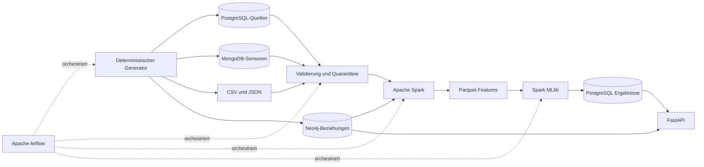

# Industrial Intelligence Platform

Eine reproduzierbare Referenzplattform für Industrial Data Engineering und Predictive Maintenance. Sie verbindet synthetische Maschinendaten aus relationalen, dokumentenorientierten, dateibasierten und Graph-Quellen mit einer validierten ETL-Strecke, Apache Spark, MLlib, Airflow und einer schlanken FastAPI.

> Die Plattform ist ein Ausbildungs- und Demonstrationssystem. Risikowerte unterstützen die Analyse, ersetzen aber keine industrielle Sicherheits-, Wartungs- oder Betriebsfreigabe.

## Problem und Ergebnis

Instandhaltungsteams müssen Messwerte, Störungen, Wartungen und technische Abhängigkeiten gemeinsam beurteilen. Dieses Projekt erzeugt einen konsistenten Fabrikdatensatz, stellt fehlerhafte Datensätze mit Grund unter Quarantäne, berechnet tägliche Maschinenmerkmale und trainiert getrennte MLlib-Modelle für Klassifikation, Regression und Clustering. Die API stellt Maschinen, Kennzahlen, Risiken und Pipeline-Läufe bereit.

## Kernfunktionen

- deterministischer Generator für 50 Maschinen, fünf Linien und bis zu 1.000.000 Messungen
- zeitliche Verläufe mit Lastphasen, Verschleiß, gezielten Störungen und optionalen Qualitätsfehlern
- PostgreSQL für Stamm-, Produktions-, Ergebnis- und Laufdaten
- MongoDB für verschachtelte Sensordokumente mit Batch-Upserts
- Neo4j für Maschinen-, Komponenten- und Abhängigkeitsbeziehungen
- reason-coded Quarantäne, Duplikatprüfung und ein reproduzierbarer Qualitätsbericht
- Airflow-DAG mit zehn fachlich getrennten Schritten ohne große XCom-Payloads
- Spark DataFrames, SQL, Joins, Window Functions, Aggregationen und Parquet
- MLlib-Pipelines für logistische Regression, Entscheidungsbaum, lineare Regression und KMeans
- chronologischer Holdout; `randomSplit` bleibt als ausdrücklich gekennzeichnetes Unterrichtsbeispiel erhalten
- FastAPI und CLI für eine überprüfbare technische Demonstration

## Architektur



Airflow steuert die Ausführung. Messreihen verbleiben in MongoDB und Parquet; Neo4j enthält bewusst nur technische Beziehungen. Das verhindert eine unnötige Million Graphknoten.

## Datenprofile

| Profil | Sensormessungen | Zweck |
|---|---:|---|
| `small` | 10.000 | Entwicklung, Unit- und E2E-Smoke-Tests |
| `medium` | 100.000 | Integration und Laufzeitmessungen |
| `full` | 1.000.000 | Abschlussdemonstration und Skalierungsnachweis |

Alle Profile verwenden denselben chunkweisen Generator. Seed, Profil, Chunkgröße und Fehlerquote lassen sich über Umgebungsvariablen setzen.

## Quickstart ohne Container

Voraussetzung: Python 3.11 bis 3.13.

```bash
python3 -m venv .venv
.venv/bin/python -m pip install -e '.[test]'
cp .env.example .env
make pipeline PROFILE=small
make test
make api
```

Danach liefert `http://localhost:8000/health` den Status. Der lokale Pipelinepfad verwendet eine transparente Regel-Baseline. Er behauptet keine MLlib-Modellleistung; der ML-Report entsteht ausschließlich durch den Spark-Lauf.

## Vollständiger Docker-Start

Empfohlen: Docker Desktop oder Docker Engine mit mindestens 8 CPU-Threads, 12 GB frei verfügbarem RAM und 15 GB freiem Speicher.

```bash
cp .env.example .env
# Passwörter und Airflow-Schlüssel in .env anpassen
docker compose config --quiet
docker compose up -d --build
docker compose --profile jobs run --rm spark-submit
docker compose exec airflow-scheduler \
  spark-submit --master spark://spark-master:7077 \
  /opt/iip/src/industrial_intelligence/ml/train.py --data-dir /opt/iip/data
```

| Dienst | URL/Port |
|---|---|
| API | `http://localhost:8000/docs` |
| Airflow | `http://localhost:8080` |
| Spark Master | `http://localhost:8081` |
| Spark Worker | `http://localhost:8082` |
| Neo4j Browser | `http://localhost:7474` |
| PostgreSQL | `localhost:5432` |
| MongoDB | `localhost:27017` |

## Typische Befehle

```bash
make generate PROFILE=small
make pipeline PROFILE=small
make compose-config
make test
make integration          # erst nach gestartetem Stack und RUN_CONTAINER_TESTS=1
make full                 # 1.000.000 Messungen
```

## API

- `GET /health`
- `GET /machines?limit=50`
- `GET /machines/{machine_id}`
- `GET /predictions?risk=high`
- `GET /pipeline-runs/latest`

## ML-Methodik

Der Feature-Datensatz enthält tägliche Aggregationen je Maschine. Für die Klassifikation trennt ein chronologischer, um den eintägigen Target-Horizont bereinigter 60/20/20-Split Training, Validierung und Test. Fünf Modelle werden mit klassenweisen Metriken, Macro-F1, Balanced Accuracy, PR-AUC, ROC-AUC und Confusion Matrix verglichen. Regression und KMeans bleiben methodisch unverändert. Echte Kennzahlen stehen in `reports/ml_report.json` und `reports/classification_benchmark.json`.

### Gemessene Ergebnisse des Full-Laufs

| Modell | Kennzahl | Wert |
|---|---|---:|
| Majority-Baseline | Accuracy / Macro-F1 / Balanced Accuracy | 0,760 / 0,432 / 0,500 |
| Finale logistische Regression | Accuracy / Macro-F1 / Balanced Accuracy | 0,723 / 0,534 / 0,537 |
| Finale logistische Regression | PR-AUC / ROC-AUC | 0,855 / 0,632 |
| Lineare Regression | RMSE / MAE | 0,521 °C / 0,443 °C |
| Mittelwert-Baseline | RMSE | 3,536 °C |
| KMeans, k=3 | Silhouette | 0,362 |

Die frühere Klassifikation sagte alle 1.000 Testfälle positiv voraus. Das neue Modell erkennt im unabhängigen Test beide Klassen (41 TN, 187 FP, 76 FN, 646 TP) und schlägt die Majority-Baseline bei Macro-F1 und Balanced Accuracy. Die Trennung bleibt schwach und synthetische Daten belegen keine reale Wartungsgüte. Der vollständige Vergleich steht im [Klassifikations-Benchmark](docs/ml/CLASSIFICATION_BENCHMARK.md).

Technischer Full-DAG-Nachweis:

```text
Messungen: 1.000.000  →  valide: 994.905  →  Quarantäne: 5.095
Spark-Features: 4.950  →  neue Testprognosen: 950 (versioniert)
MongoDB-Dokumente: 1.000.000  |  Neo4j: 270 Knoten / 400 Beziehungen
Airflow industrial_etl: success
```

## Tests und Nachweise

- schnelle Tests: `make test`
- Containerintegration: `RUN_CONTAINER_TESTS=1 make integration`
- Compose-Validierung: `make compose-config`
- Spark-Transformation: `docker compose --profile jobs run --rm spark-submit`
- Full-Profil: `make full`

Der aktuelle, datierte Ausführungsstatus steht im [Abschlussbericht](docs/FINAL_REPORT.md). Nicht ausgeführte Services oder Modelle werden dort als solche gekennzeichnet.

## Projektstruktur

```text
src/industrial_intelligence/  Generator, Qualität, ETL, API, DB-Adapter, Spark, MLlib
dags/                         Airflow-DAG
sql/                          PostgreSQL-Schema und Industrieabfragen
cypher/                       Neo4j-Constraints und Graphabfragen
scripts/                      MongoDB-Initialisierung
tests/                        Unit-, Integrations- und E2E-Tests
docs/                         Architektur, Betrieb, Methodik, Kursabdeckung
presentation/                 Zehn-Minuten-Präsentation und Demo-Unterlagen
```

## Dokumentation

- [Architektur und Datenfluss](docs/architecture/ARCHITECTURE.md)
- [Datenbanken](docs/databases/DATABASES.md)
- [ETL und Datenqualität](docs/etl/ETL.md)
- [Airflow](docs/airflow/AIRFLOW.md)
- [Spark](docs/spark/SPARK.md)
- [MLlib](docs/ml/ML_REPORT_GUIDE.md)
- [Klassifikations-Benchmark](docs/ml/CLASSIFICATION_BENCHMARK.md)
- [Tests](docs/testing/TESTING.md)
- [Betrieb](docs/operations/RUNBOOK.md)
- [Unterrichtsabdeckung](docs/COURSE_COVERAGE.md)
- [Abschlussbericht](docs/FINAL_REPORT.md)

## Grenzen

- Synthetische Daten belegen keine reale Modellgüte oder industrielle Einsatzfähigkeit.
- Eine Million Zeilen rechtfertigen allein noch keinen Spark-Cluster; Spark demonstriert hier eine Architektur, die bei größeren Quellen, längeren Historien und komplexeren Joins skaliert.
- Containerintegration und MLlib benötigen Docker-Ressourcen und müssen auf dem Zielrechner ausgeführt werden.
- Die FastAPI ist bewusst eine technische Oberfläche und kein Produktionsfrontend.

## Lizenz

MIT, siehe [LICENSE](LICENSE).
