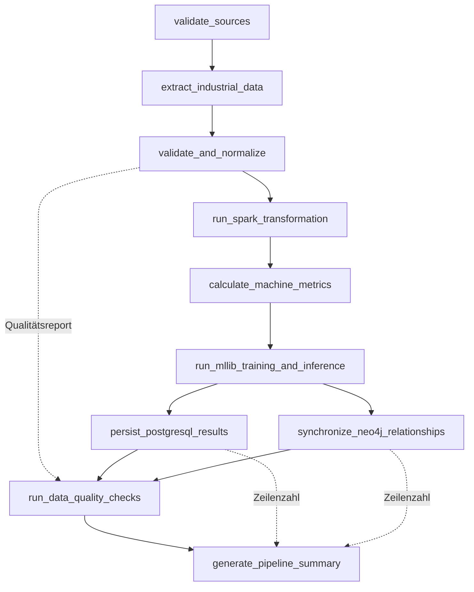

# Airflow-Ausführungsfluss

## DAG-Konfiguration

| Eigenschaft | Wert |
|---|---|
| DAG-ID | `industrial_etl` |
| Schedule | täglich `0 2 * * *` |
| Catch-up | deaktiviert |
| maximale aktive Läufe | 1 |
| Executor | `LocalExecutor` |
| Retries | 2 |
| Retry-Abstand | 3 Minuten |
| Standard-Timeout | 2 Stunden |
| Startstatus | durch Compose bei Erstellung pausiert |

Der verifizierte Scheduler listet den DAG ohne Importfehler. Der jüngste gespeicherte Lauf `manual__2026-10-19T08:00:00+00:00` endete am 19. Oktober 2026 um 08:01:44 UTC mit `success`.

## Abhängigkeiten

Die gestrichelten Kanten transportieren kleine Metadaten per XCom. Sensordaten, Parquet, Modelle und Vorhersagen liegen auf Volumes.

## Tasks

| Nr. | Task-ID | Implementierung | Konkrete Arbeit | Ergebnis |
|---:|---|---|---|---|
| 1 | `validate_sources` | TaskFlow-Python | Datenverzeichnis anlegen, Profil melden | kleines Metadata-Dict |
| 2 | `extract_industrial_data` | TaskFlow-Python und `_run()` | Generator sowie `load-sources` starten | Quelldateien, PostgreSQL- und MongoDB-Daten |
| 3 | `validate_and_normalize` | TaskFlow-Python und `_run()` | Python-Validierung starten und Qualitätsreport lesen | CSV, Quarantäne, XCom-Report |
| 4 | `run_spark_transformation` | `BashOperator` | Transformationsjob am Spark-Master starten | Parquet-Features und Linienmetriken |
| 5 | `calculate_machine_metrics` | `BashOperator` | lokale Referenzmetriken berechnen | 50 Maschinenmetriken und Regelprognosen |
| 6 | `run_mllib_training_and_inference` | `BashOperator` | Klassifikation, Regression und KMeans ausführen | Modelle, Reports, 950 Testprognosen |
| 7 | `persist_postgresql_results` | TaskFlow-Python | 50 Metriken und 950 neue Prognosen upserten | Rückgabewert 1.000 |
| 8 | `synchronize_neo4j_relationships` | TaskFlow-Python | 200 Komponenten-CSV-Zeilen synchronisieren | Rückgabewert 200 |
| 9 | `run_data_quality_checks` | TaskFlow-Python | Anteil verworfener Zeilen gegen zwei Prozent prüfen | Gate `passed` oder Exception |
| 10 | `generate_pipeline_summary` | TaskFlow-Python | kompakte Laufzusammenfassung schreiben | `reports/airflow_latest.json` |

## Fehlerverhalten

`_run()` sammelt Standardausgabe und Fehlerausgabe eines Unterprozesses. Bei einem Returncode ungleich null löst die Funktion eine `AirflowException` mit dem Ende der Fehlerausgabe aus. BashOperator-Fehler führen ebenfalls zum Taskfehler. Airflow wiederholt Tasks entsprechend der Retry-Konfiguration.

Das Qualitätsgate schlägt fehl, wenn `valid == 0` oder der Ausschussanteil größer als 0,02 ist. Im verifizierten Full-Lauf betrug die Quote 0,5095 Prozent.

## Wichtige Ausführungsgrenze

Das Gate liegt nach MLlib und nach beiden Persistenz-Tasks. Es schützt damit den finalen DAG-Status, verhindert aber nicht, dass PostgreSQL und Neo4j bereits geschrieben wurden. Für ein striktes Publish-Gate müsste `run_data_quality_checks` vor Spark und Persistenz liegen. Der aktuelle Auftrag verändert diese Architektur nicht, sondern dokumentiert sie.

## Separat gestartete Komponenten

- PostgreSQL, MongoDB, Neo4j, Spark Master/Worker, App, Airflow Webserver und Scheduler starten über Docker Compose.
- Der DAG startet diese Container nicht.
- Der DAG startet die Spark-Anwendungsprozesse per `spark-submit`.
- Der Compose-Service `spark-submit` ist eine separate manuelle Alternative für den Transformationsjob und kein DAG-Task.
- FastAPI wird vom DAG weder gestartet noch neu geladen. Sie liest nach erfolgreichem Lauf die aktualisierten Dateien vom gemeinsamen Volume.
