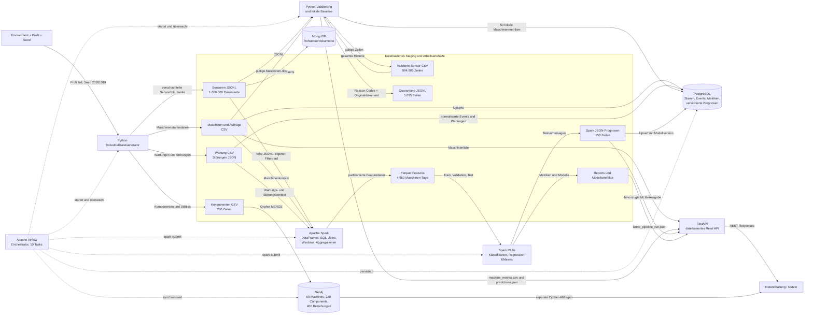

# Pipeline-Diagramm

## End-to-End-Architektur

## Leseregeln

- Durchgezogene Pfeile zeigen tatsächlichen Datenfluss.
- Gestrichelte Pfeile zeigen Steuerung oder eine bewusst getrennte Nutzung.
- Airflow ist kein Speicher.
- MLlib ist Teil der Verarbeitung und keine Datenquelle.
- Neo4j liegt außerhalb des Vorhersagepfads.
- FastAPI liest im aktuellen Stand Dateien. Die PostgreSQL-Persistenz der Prognosen wird nicht für die API-Antwort verwendet.
