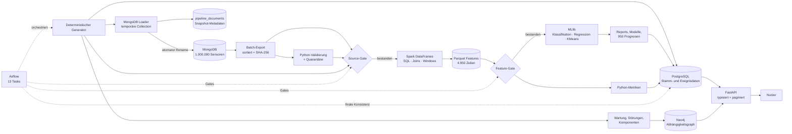

# Pipeline-Diagramm

## Leseregeln

- MongoDB ist die Quellinstanz für Spark. Der JSONL-Export ist ein beobachteter Snapshot mit Manifest, kein unabhängiges Rohdatensystem.
- PostgreSQL ist die Serving-Quelle für Maschinen, Metriken, Prognosen und Pipeline-Läufe.
- Neo4j ist die Serving-Quelle für Komponentenabhängigkeiten. Der Graph fließt nicht in MLlib ein.
- Beide Gates liegen vor MLlib. Die finale Konsistenzprüfung liegt nach den Persistenzschritten und darf nur einen vollständig veröffentlichten Lauf als erfolgreich markieren.
